# Agent Workspace OS

A local-first, cloud-capable workspace for safe AI agents and generated apps.

Agent Workspace OS combines the practical desktop workflow of an AI client with the capability security, isolated execution, and sharing model of an AI application platform. This repository contains the first runnable MVP and reference architecture.

  

## Screenshots

### Ask — local-first workspace

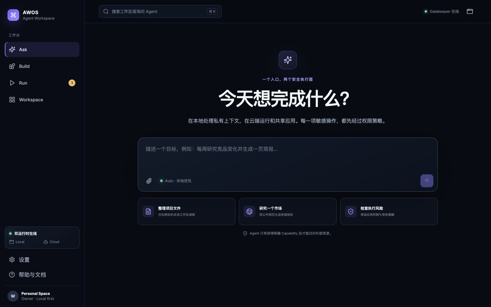

### Build — runtime and capability manifest

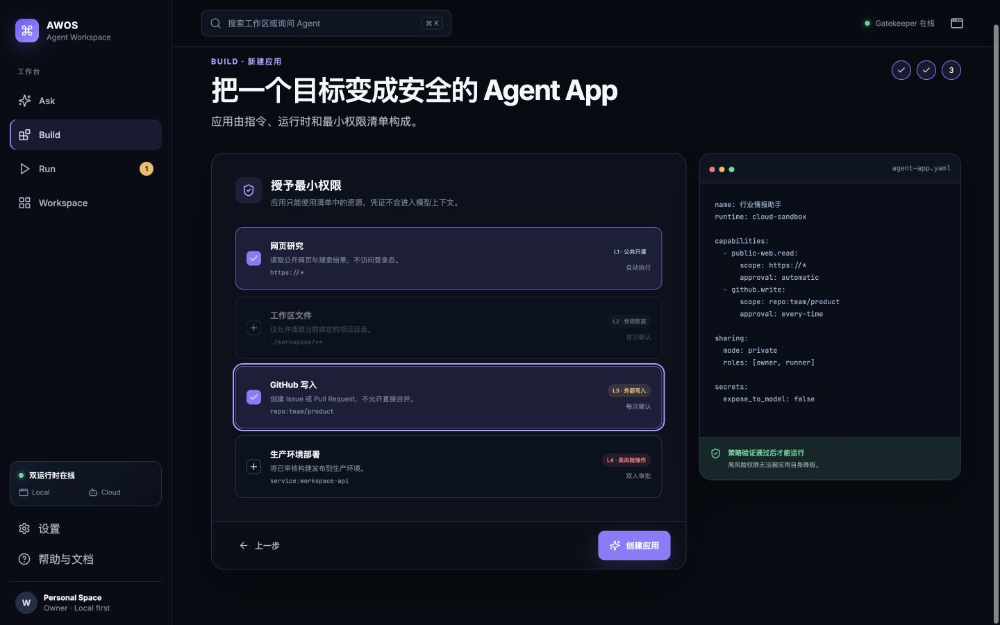

### Templates — repeatable work without repeated setup

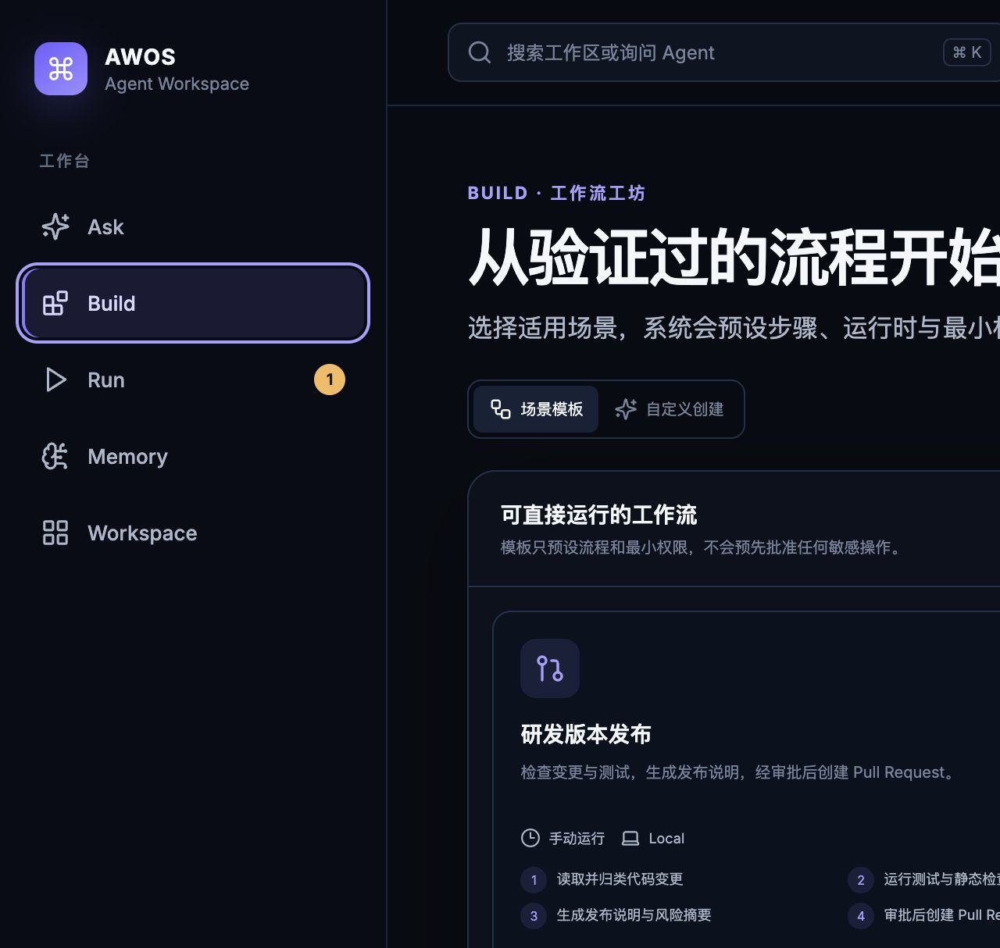

### Run — approval and audit checkpoint

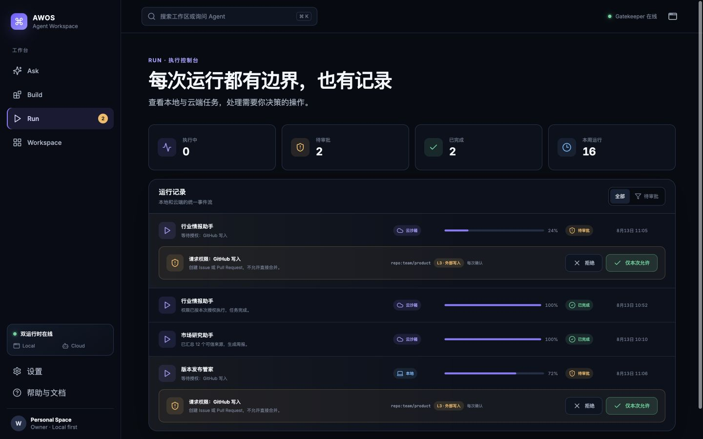

### Memory — Letta-backed reusable workflows

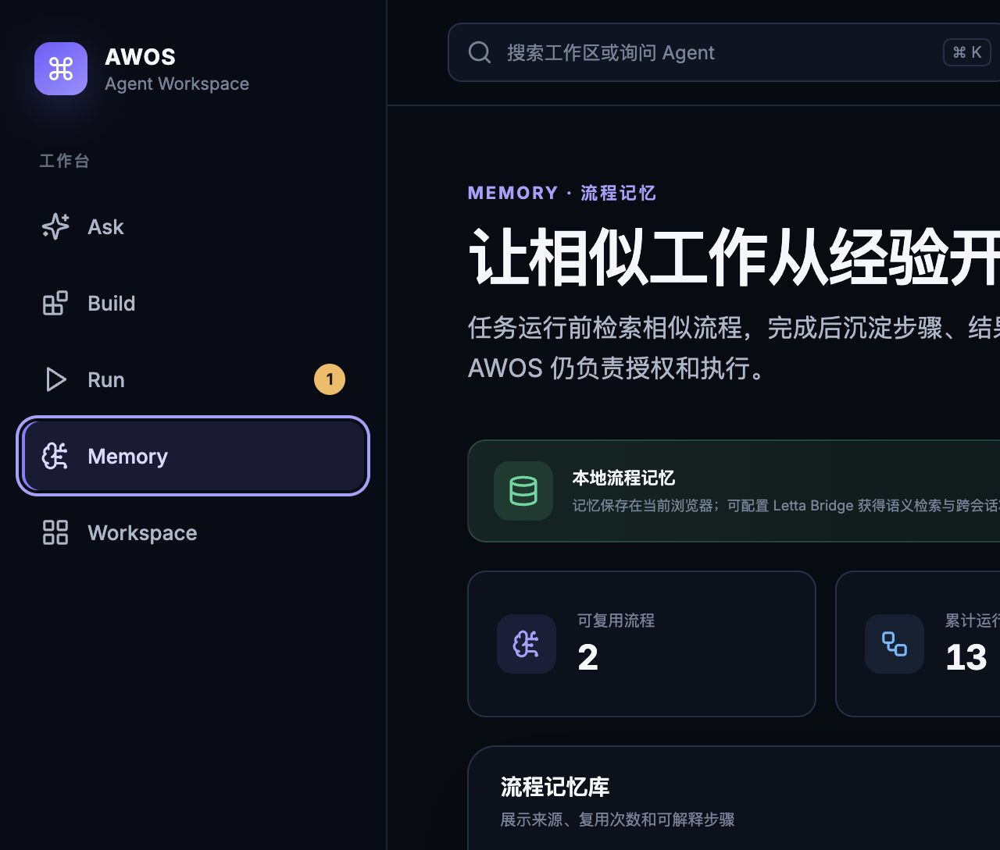

### Workspace — enterprise identity and integration posture

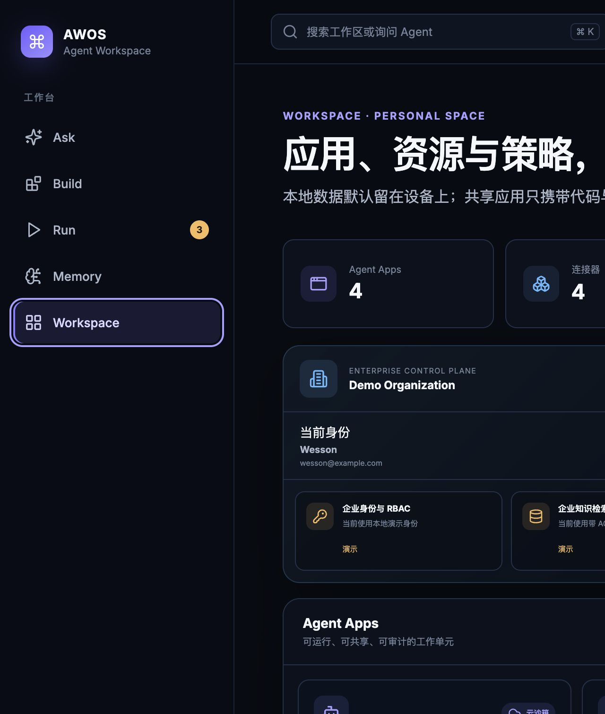

<details>
<summary>Run with a similar-workflow match</summary>

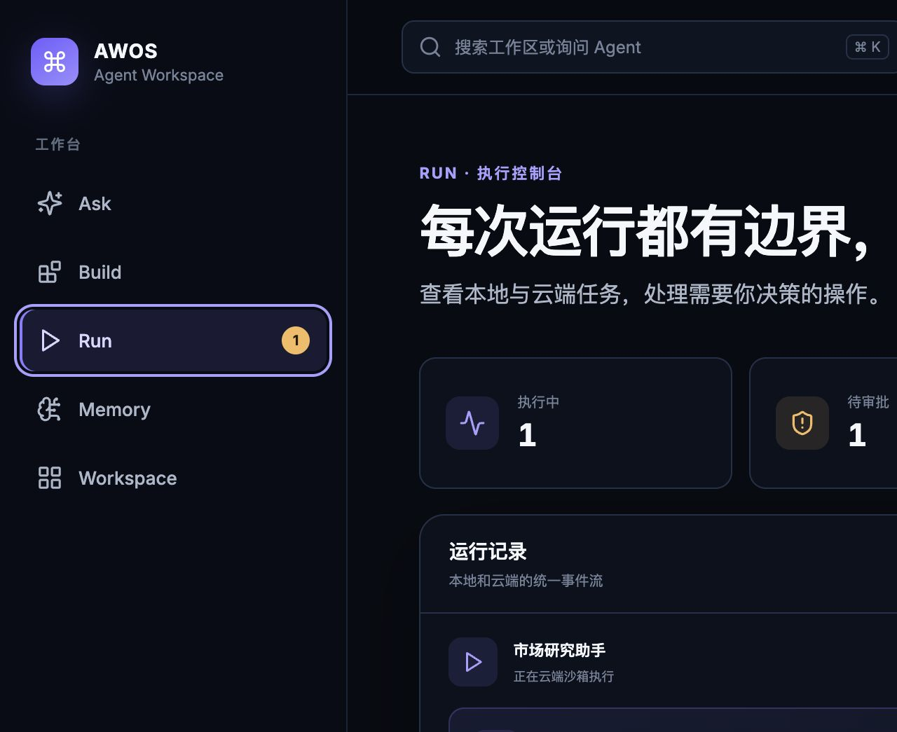

</details>

<details>
<summary>Versioned Workflow Studio and run preflight</summary>

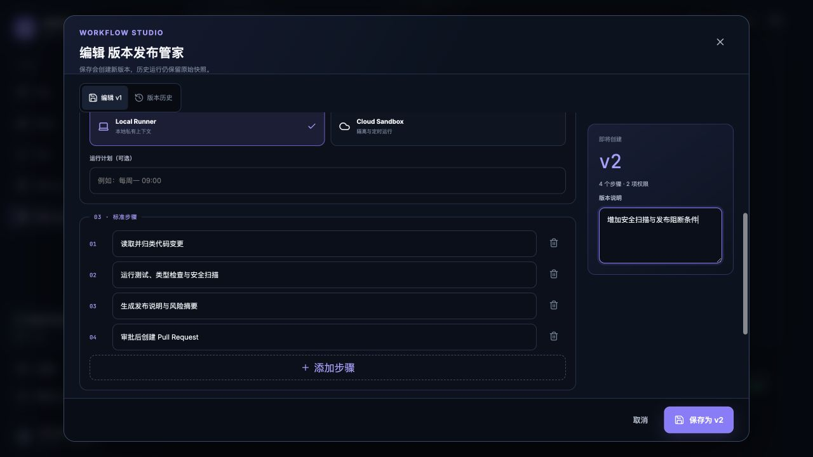

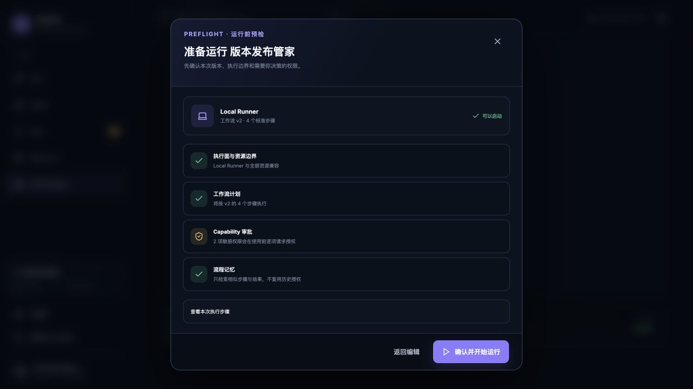

</details>

<details>
<summary>Explainable five-phase run trace</summary>

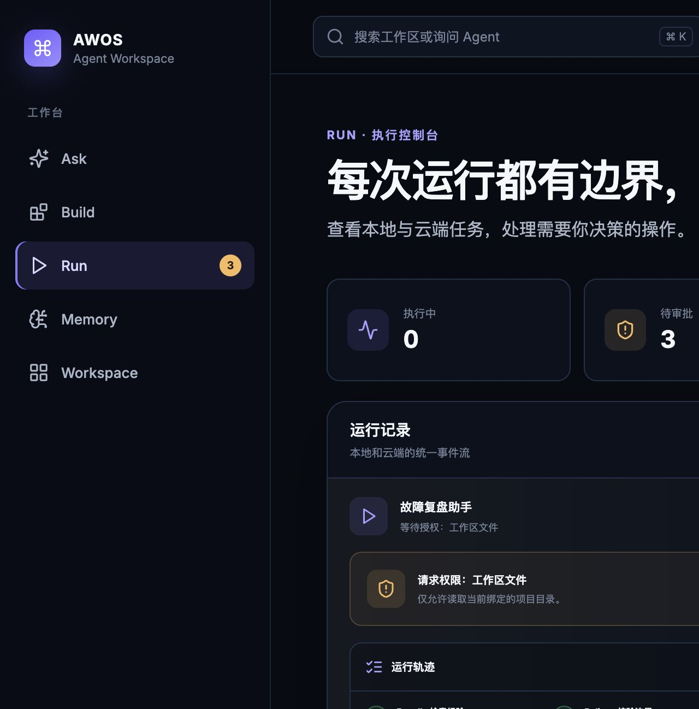

</details>

<details>
<summary>Mobile layout</summary>

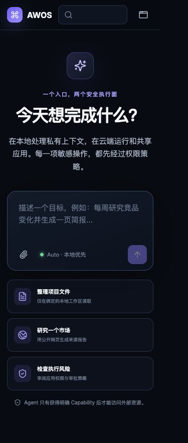

</details>

## What works

- Ask: a local demo conversation that can become a reusable Agent App.
- Build: a three-step app builder for prompts, local/cloud runtime, and capabilities.
- Templates: ready-to-use research, release, incident-review, and content workflows with explicit deliverables.
- Workflow Studio: edit goals, runtime, steps, schedules, and capabilities while retaining immutable version snapshots.
- Run: unified execution feed with approval and denial checkpoints.
- Run preflight: review the exact workflow version, runtime boundary, approval count, and memory behavior before execution.
- Run trace: visible Recall → Policy → Gate → Execute → Reflect phases and expandable execution plans.
- Memory: similar-workflow recall, explainable ranking, reusable steps, and completion-time reflection.
- Workspace: apps, audit events, runtime status, and security posture.
- Capability policy engine with five risk levels and safe defaults.
- Local and cloud runtime interfaces with fail-closed validation.
- Local persistence for the demo workspace.
- Optional Letta archival-memory integration through a server-side bridge, with local fallback.
- Optional Enterprise Gateway for signed identity assertions, RBAC, tenant/group-scoped knowledge retrieval, and server-side run preflight.
- Enterprise Control Plane status in Workspace, with explicit ready/demo/pending integration states.
- Responsive desktop/mobile interface and keyboard-visible focus states.
- 29 unit tests and GitHub Actions CI.

## Run locally

Requirements: Node.js 20.17 or newer.

```bash
npm install
npm run dev
```

Then open `http://localhost:4173`.

### Enable Letta memory (optional)

The app works without Letta and stores workflow memories in the browser. To enable semantic, cross-session retrieval:

1. Copy `.env.example` to `.env`.
2. Set `LETTA_AGENT_ID` and either `LETTA_API_KEY` for Letta Cloud or `LETTA_BASE_URL=http://localhost:8283` for a self-hosted server.
3. Start the trusted bridge with `npm run memory:server`.
4. In another terminal, start the UI with `npm run dev`.

Only the bridge reads `LETTA_API_KEY`; the browser receives no long-lived credential. The integration uses Letta Agent archival memory (Passages) for semantic recall, while AWOS keeps deterministic ranking, permission checks, execution, and audit ownership.

### Enable the enterprise control plane (optional)

The repository includes a narrow Enterprise Gateway. It can run with a local demo identity or behind an identity-aware proxy that injects a short-lived signed assertion.

```bash
npm run enterprise:server
```

Set `VITE_ENTERPRISE_API_URL=http://127.0.0.1:8788` for the UI. In demo mode the gateway exposes a tenant-scoped, group-filtered sample knowledge source. In production, set `ENTERPRISE_KNOWLEDGE_SEARCH_URL` to an existing RAG/search service and switch `AWOS_ENTERPRISE_AUTH_MODE` to `proxy`.

See the [Chinese enterprise integration guide](docs/ENTERPRISE_INTEGRATION_CN.md) for the identity assertion contract, knowledge adapter schema, deployment sequence, and remaining production work.

Validate the project:

```bash
npm run check
```

## Security boundary

This MVP deliberately simulates task execution. The optional Memory Bridge can access a configured Letta server, but it does not run generated shell commands, hold connector OAuth credentials, or access production tools. It demonstrates where those capabilities plug in and how policy gates them.

Do not treat the browser demo as a production sandbox. Read [the architecture](docs/ARCHITECTURE.md) and [security model](docs/SECURITY.md) before adding real tools.

Chinese interview preparation: [技术架构与面试讲解](docs/INTERVIEW_GUIDE_CN.md).

## Principles

1. Local context stays local unless the user grants otherwise.
2. Generated code is untrusted by default.
3. Apps declare the exact capabilities they need.
4. Credentials never enter model context.
5. Writes are previewed and high-risk actions need stronger approval.
6. Every decision is auditable.

## Next milestones

- Server-side Gatekeeper and signed, short-lived capability grants.
- Letta agent provisioning, durable multi-workspace memory namespaces, and evaluation-based memory promotion.
- Sandboxed local runner and deny-by-default cloud worker runtime.
- Model gateway adapters for OpenAI, Anthropic, Gemini, and Ollama.
- OAuth connector broker for GitHub, mail, and databases.
- Organizations, RBAC, real-time collaboration, and durable audit storage.
- Production OIDC/JWT session handling, Postgres event storage, a queued sandbox runtime, and signed short-lived Capability Grants.

## License

MIT. This is a clean-room reference implementation and does not copy source code from Cherry Studio or Cloudflare OS.
