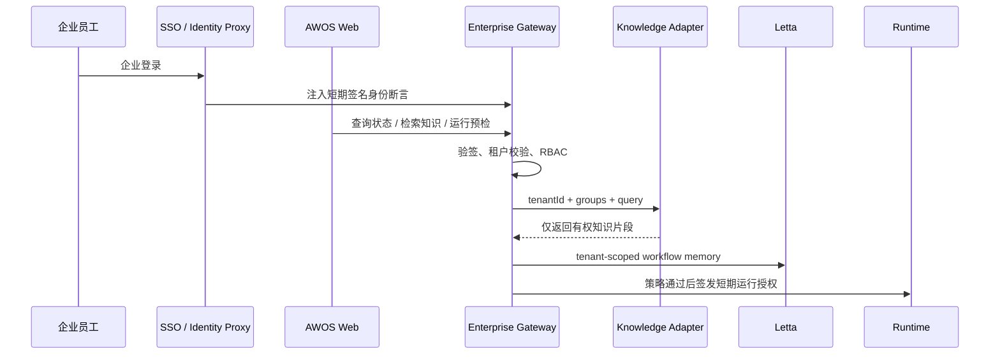

# Agent Workspace OS 企业接入实施指南

这份指南把当前项目从个人演示工作区接入到企业内部知识工作流。目标不是一次性替换企业现有系统，而是在现有身份、知识库、审批和审计系统之上增加 Agent 编排层。

## 当前已经实现

- 企业网关：浏览器只访问窄 API，不接触企业知识库、Letta 或连接器密钥。
- 企业身份断言：支持上游身份代理注入短期 HMAC 签名身份，网关验证签名、有效期和租户。
- RBAC：内置 member、builder、approver、admin 四类角色与服务端权限检查。
- 知识 ACL：查询携带租户和用户组；演示适配器会在服务端过滤跨租户和无权文档。
- 外部知识适配器：可将查询转发至企业现有 RAG、Elasticsearch、OpenSearch 或内部搜索 REST API。
- 服务端运行预检：启动前重新校验 Capability、Runtime 和当前企业身份，前端结果不作为最终授权依据。
- Letta 租户标签：工作流记忆带 `tenant:<id>` 标签，搜索、列表和删除都限制在当前租户。
- 企业状态面板：Workspace 可展示组织、当前身份、角色、用户组以及身份/知识/记忆/审计接入状态。
- 企业方案工作流：内置需要首次审批的“企业客户方案助手”，审批后才检索内部知识，并在 Run 中显示可追溯证据。
- 本地兼容：不配置企业网关时，项目仍可作为个人工作区运行。

## 企业请求链路



当前仓库已经覆盖到“策略通过”之前；生产 Runtime 和短期 Capability Grant 仍属于下一阶段。

## 本地演示接入

复制环境变量：

```bash
cp .env.example .env
```

保留：

```dotenv
VITE_ENTERPRISE_API_URL=http://127.0.0.1:8788
AWOS_ENTERPRISE_AUTH_MODE=demo
AWOS_TENANT_ID=tenant-demo
AWOS_ORGANIZATION_NAME=Acme Knowledge Operations
```

分别启动：

```bash
npm run enterprise:server
npm run dev
```

打开 `http://localhost:4173`，Workspace 页面会展示企业控制面。演示身份能看到产品和销售知识，不能看到 finance 用户组文档。

测试知识检索：

```bash
curl -X POST http://127.0.0.1:8788/api/knowledge/search \
  -H 'content-type: application/json' \
  -d '{"query":"客户 方案","limit":5}'
```

## 接入真实企业身份

推荐在网关前放置企业现有的 Identity-Aware Proxy，例如 oauth2-proxy、Cloudflare Access、API Gateway 或公司统一接入层：

1. 企业身份平台完成 OIDC/SAML 登录。
2. 身份代理将 `sub`、`email`、`name`、`tenantId`、`roles`、`groups` 组成短期断言。
3. 代理用共享密钥进行 HMAC-SHA256 签名。
4. 断言放入 `x-awos-identity`，签名放入 `x-awos-identity-signature`。
5. Enterprise Gateway 验证签名、`iat`、`exp`、租户和角色。

生产配置：

```dotenv
AWOS_ENTERPRISE_AUTH_MODE=proxy
AWOS_IDENTITY_HMAC_SECRET=<至少 32 位随机服务端密钥>
AWOS_TENANT_ID=<固定租户 ID>
```

HMAC 是当前参考实现的清晰最小边界。大规模部署建议升级为短期 JWT/JWKS，支持密钥轮换、issuer/audience 校验和撤销策略。

## 接入企业知识库

AWOS 不要求迁移现有知识。企业搜索服务只需接受：

```json
{
  "query": "客户方案",
  "limit": 8,
  "tenantId": "tenant-acme",
  "groups": ["sales", "product"]
}
```

并返回有权文档片段：

```json
[
  {
    "id": "doc-001",
    "title": "客户解决方案交付检查清单",
    "excerpt": "交付前确认客户规模、知识源……",
    "source": "Confluence",
    "url": "https://knowledge.example.com/doc-001",
    "updatedAt": "2026-08-01T08:00:00.000Z"
  }
]
```

配置：

```dotenv
ENTERPRISE_KNOWLEDGE_SEARCH_URL=https://knowledge.internal.example.com/search
ENTERPRISE_KNOWLEDGE_TOKEN=<仅服务端保存的 token>
```

ACL 必须由企业知识服务和 Enterprise Gateway 服务端执行，不能依赖前端隐藏结果，也不能让模型自行判断访问权限。

## 接入 Letta

Letta 只保存跨任务的流程经验，不替代企业知识库：

- 产品制度、客户资料：企业知识库/RAG。
- 业务事实：CRM、ERP、数据库。
- 流程偏好、纠错和成功模式：Letta。
- 运行日志与审批证据：审计存储。

当前 Memory Bridge 会为 Passage 增加 `tenant:<id>`，并在搜索、列表和删除时校验该租户。生产部署更推荐每租户独立 Letta Agent 或 Archive，再叠加租户标签作为纵深防御。

## 上线前仍未完成

| 项目 | 当前状态 | 生产要求 |
|---|---|---|
| SSO 登录页与会话 | 已实现可信代理协议，未绑定具体 IdP | 接入公司 OIDC/SAML、会话刷新、登出和撤销 |
| 数据库 | 浏览器 localStorage | Postgres 保存工作流、运行、审批和审计事件 |
| 真实执行器 | 浏览器模拟状态机 | 沙箱 Worker/容器、队列、超时、重试、幂等和取消 |
| Capability Grant | 服务端预检 | Gatekeeper 签发一次性、短期、资源级授权票据 |
| 双人审批 | 有策略模型，未持久化审批人 | 两个不同主体、审批过期、职责分离与证据链 |
| 知识同步 | REST 查询适配边界 | Confluence/SharePoint/飞书等增量同步和权限映射 |
| Letta 隔离 | 租户标签 | 每租户 Agent/Archive、生命周期、冲突和遗忘策略 |
| 模型调用 | 尚未接入 | 企业模型网关、脱敏、路由、配额、成本与内容安全 |
| 审计 | 前端事件 + 接入状态 | append-only Postgres/WORM/SIEM、导出和留存策略 |
| 可观测性 | 基础运行 trace | OpenTelemetry、指标、告警、质量评测和 SLO |
| Secrets | 环境变量示例 | Vault/KMS、短期凭证和轮换 |
| 安全测试 | 单元测试 | 渗透测试、Prompt Injection、越权和供应链检查 |

## 推荐实施顺序

1. 选择一个高频、标准化、有人审核的流程，例如售前方案或周报。
2. 接入公司 IdP 和一个只读知识源，先验证身份到文档 ACL 的完整链路。
3. 上 Postgres 和审计事件，确保每次检索、授权和运行可追溯。
4. 接入模型网关，只生成草稿，不自动对外写入。
5. 增加一个受控写入连接器，并使用每次审批。
6. 部署沙箱 Runtime、队列与短期 Capability Grant。
7. 接入 Letta，沉淀稳定流程经验并建立记忆质量评测。
8. 达到质量、安全和成本指标后再扩展到更多部门。

第一期验收应关注：知识引用准确率、ACL 越权率（必须为零）、初稿采纳率、人工修改率、任务成功率、平均耗时、审批次数和单次成本。
