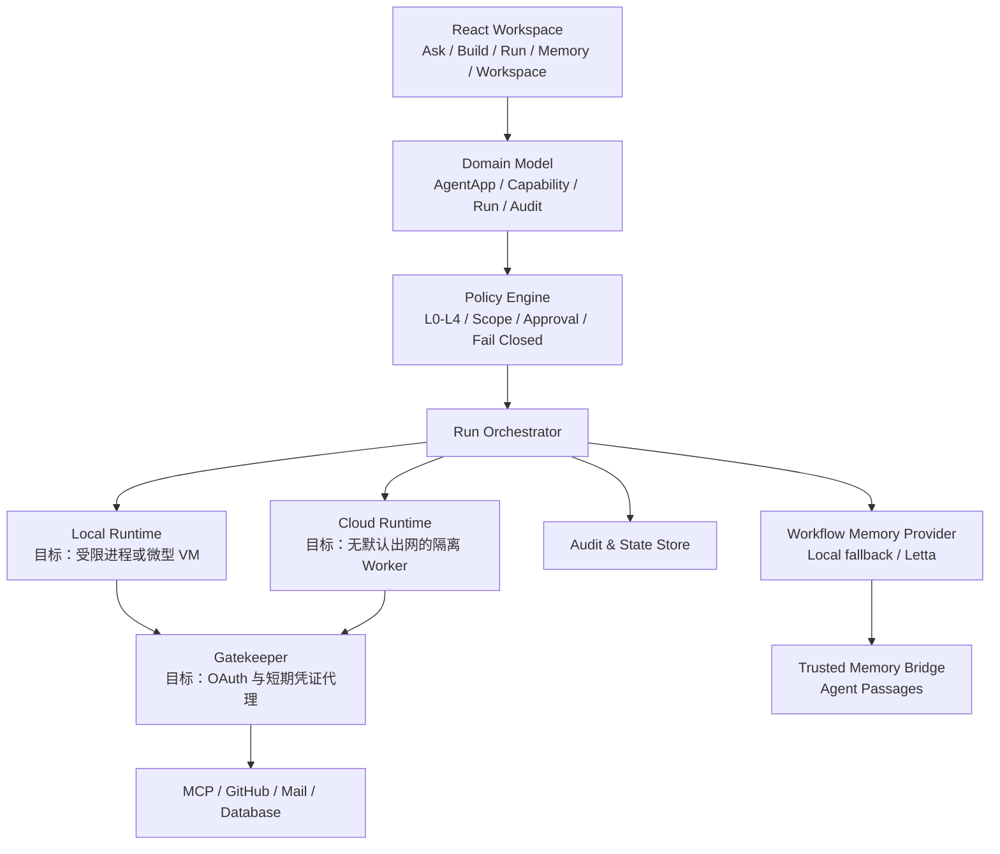
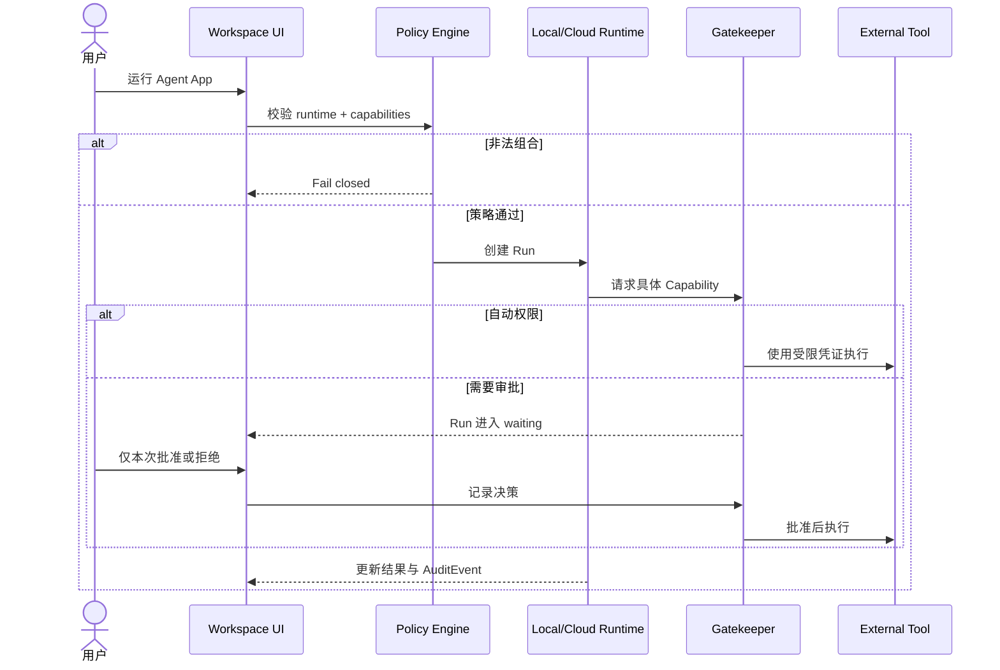

# Agent Workspace OS：技术架构与面试讲解

这份文档用于简历项目介绍和技术面试。讲解时要明确：当前仓库是一个可运行的 MVP 与安全架构参考实现，已经完成权限策略、双运行时抽象、审批审计闭环，以及可选的 Letta 长期流程记忆 Bridge；真实模型网关、OAuth 凭证代理和操作系统级沙箱属于下一阶段生产化工作。

## 一句话介绍

Agent Workspace OS 是一个本地优先、云端可协作的 AI Agent 工作空间。我把对话、应用生成、双运行时、Capability 权限、人工审批、审计和 Letta 长期流程记忆统一成一个完整闭环，让相似任务能复用经验，但不能复用旧授权。

## 为什么做这个项目

普通 AI 客户端擅长访问本地文件和工具，但 Agent 一旦获得终端、文件或第三方账号权限，安全边界会比较宽；云端 AI 应用平台隔离和协作能力更好，但本地隐私数据和开发工具接入不够自然。

这个项目要解决的核心矛盾是：既让 Agent 真正完成任务，又不把整台电脑或完整账号权限直接交给模型。

## 当前 MVP 技术栈

| 层次 | 当前实现 | 选择理由 |
|---|---|---|
| UI | React 19、TypeScript、Vite | 类型安全、组件化，适合快速验证复杂交互 |
| 图标与设计 | Lucide、CSS Design Tokens、响应式布局 | 统一视觉语言，无框架绑定 |
| 状态 | React State + LocalStorage | MVP 零后端运行，保留替换持久层的边界 |
| 流程记忆 | Provider 抽象 + 本地镜像 + Letta SDK 1.12 | 语义召回跨会话经验，故障时仍可运行 |
| Memory Bridge | Node HTTP + Letta TypeScript SDK | API Key 只留服务端，前端不接触长期凭证 |
| 场景模板 | 目标、交付物、步骤、Runtime、Capability | 让高频工作可以直接创建，同时复用统一策略校验 |
| 运行轨迹 | Recall / Policy / Gate / Execute / Reflect | 将 Agent 黑盒过程变成可解释、可中断的领域状态 |
| 领域层 | App、Capability、Run、AuditEvent | 将聊天之外的执行对象显式建模 |
| 策略层 | L0–L4 风险、审批映射、Runtime 校验 | 策略与 UI、运行时解耦，默认拒绝非法组合 |
| 运行时 | `AgentRuntime`、`LocalRuntime`、`CloudRuntime` | 用统一接口屏蔽本地沙箱和云端 Worker 差异 |
| 质量 | ESLint、Vitest、TypeScript、GitHub Actions | 本地与远端使用同一条 `npm run check` |

## 系统架构



当前代码中，领域模型、策略层和运行时接口已经落地；Local/Cloud 执行过程是安全模拟，不会真实运行 Shell、保存 OAuth Token 或访问生产服务。

## Letta 为什么加在这里

工作中的周报、发布、资料整理和排障往往高度相似。只保存聊天历史，下一次很难稳定召回“上次成功用了哪些步骤、哪些权限、结果怎样”。因此我把一次成功运行提炼成 `WorkflowMemory`：目标、运行时、Capability、流程指纹、步骤、结果和复用次数。

启动任务时，Letta archival memory 做语义召回；AWOS 再用目标词、运行时、Capability 和流程指纹二次排序，并在 UI 中解释命中原因。完成任务后，相同指纹的记忆会合并更新，而不是无限新增重复记录。

最重要的边界是：Letta 只负责 Context Plane，不负责 Control Plane。历史流程里即使写过 GitHub，本次运行仍必须重新经过 Gatekeeper 审批。

## 核心数据模型

### AgentApp

可复用的执行单元，包含目标提示词、运行时、Capability 清单和状态。相比把所有事情塞在聊天记录里，App 可以被校验、运行、审计和共享。

### Capability

不是简单的“是否允许调用工具”，而是完整声明：

```ts
interface Capability {
  resource: string
  scope: string
  mode: 'read' | 'write' | 'execute'
  risk: 0 | 1 | 2 | 3 | 4
  approval: 'automatic' | 'first-use' | 'every-time' | 'two-person'
}
```

例如 GitHub 写入只允许 `repo:team/product`，风险为 L3，每次操作都要确认；生产部署是 L4，不能被应用自行降级为自动批准。

### Run 与 AuditEvent

Run 表示一次可追踪执行，状态包括运行中、待审批、完成和失败。每次允许、阻止、批准和拒绝都会生成 AuditEvent。生产环境中审计事件应写到服务端 append-only 存储，不能由 Agent 修改。

## 一次执行的完整链路



## 最值得讲的六个技术点

### 1. 权限不是弹窗，而是领域模型

我没有在按钮点击时临时判断，而是把资源、作用域、读写模式、风险等级和审批策略建成 Capability。这样 UI、运行时、审计和未来的组织策略都使用同一份语义。

### 2. 双运行时使用统一接口

本地运行适合私有文件和 Coding Agent；云运行适合定时任务、共享与隔离。两者实现同一个 `AgentRuntime` 接口，业务层只依赖抽象。将来可以把当前模拟实现替换成 Tauri sidecar、容器、Cloudflare Worker 或 Kubernetes Job，而不需要重写产品流程。

### 3. 默认拒绝而不是默认放行

策略层会拒绝云运行时读取本地文件，也会拒绝 L4 权限被降级。测试覆盖了安全默认值、跨运行时非法组合和审批暂停。这个设计避免安全逻辑散落在组件中。

### 4. 记忆是可替换的基础设施，不侵入业务

我定义 `WorkflowMemoryProvider`，本地和 Letta 都实现同一接口。Letta 不可达时回退到 LocalStorage 镜像；恢复后可继续语义检索。召回与排序也分层：Letta 负责高召回的语义候选，AWOS 负责可测试、可解释的确定性排序。这样既获得长期记忆，也不会把产品逻辑绑死在单一向量服务上。

### 5. 模板和运行轨迹让系统真正可用

我没有把模板实现成绕过策略的快捷按钮，而是让模板生成普通 `AgentApp`，继续走相同的 Runtime 与 Capability 校验。运行时进一步显式建模 Recall、Policy、Gate、Execute、Reflect 五个阶段：审批拒绝会将后续阶段标记为 blocked，成功完成才进入记忆沉淀。这样用户能看到任务停在哪里，面试时也能说明系统不是不可解释的 Agent 黑盒。

### 6. 工作流版本和 Preflight 保证变更可追溯

真实团队会不断修改步骤、运行计划和权限范围，所以工作流不能只是一个会被覆盖的 Prompt。项目把每次保存变成不可变快照；恢复旧版本也会创建新版本，因此历史运行始终能解释“当时到底执行了什么”。运行前 Preflight 会统一检查执行面兼容性、步骤完整性、敏感权限数量和记忆边界，阻止不兼容配置进入 Runtime。

## 30 秒面试版本

我做了一个本地优先、云端可协作的 AI Agent 工作空间。它把执行建模成 Agent App、Capability、Run、WorkflowMemory 和 AuditEvent，内置研发发布、市场研究、故障复盘等模板。工作流支持不可变版本与运行前 Preflight；运行会经过 Recall、Policy、Gate、Execute、Reflect 五个可观察阶段，多个敏感 Capability 必须逐项审批。相似任务从 Letta 召回经验，但旧授权绝不会被复用。目前已完成可运行 MVP、24 个测试和 CI；真实沙箱与 OAuth Gatekeeper 是下一阶段。

## 2 分钟面试版本

这个项目来源于一个矛盾：桌面 AI 工具能操作本地文件和终端，但权限边界太宽；云端 Agent 平台隔离更好，却不擅长使用本地上下文。因此我设计了 Local Runner 和 Cloud Sandbox 两个执行面。

用户可以从对话开始，把需求转换成 Agent App。App 必须声明运行时和 Capability。Capability 包含 resource、scope、mode、risk 和 approval，不允许 Agent 直接拿完整 Token。策略引擎在执行前校验组合，例如云端不能申请本地文件，L4 生产操作必须双人审批。需要确认的 Run 会暂停，用户批准或拒绝后继续，并写入审计事件。

为了处理大量相似工作，我增加了 Letta 流程记忆层。运行前先语义召回，再用 runtime、Capability 和 workflow fingerprint 做二次评分；命中结果会展示相似度、信号和历史步骤。任务完成后更新同一个流程记忆。这里刻意把记忆和授权分开，避免“上次允许过”变成“以后永久允许”。

代码层面我把领域模型、策略、运行时、记忆 Provider 和 UI 分开。`AgentRuntime` 是执行边界，`WorkflowMemoryProvider` 是记忆边界，所以模拟运行时和本地记忆之后都能独立替换。项目使用 React、TypeScript、Vite、Letta TypeScript SDK、Vitest 和 GitHub Actions，24 个测试和生产构建都在 CI 中通过。

当前我会诚实说明，它还是架构 MVP，没有把浏览器前端描述成真实安全沙箱。下一步会把策略决策迁到服务端，使用签名的短期 Capability Grant，通过 Gatekeeper 代理 OAuth Token，并为本地运行增加 OS Sandbox 或微型 VM。

## 面试官可能追问

### 为什么不用 MCP 权限本身？

MCP 解决模型如何发现和调用工具，但不能完整解决组织策略、凭证隔离、跨工具风险分级和双人审批。系统把 MCP 当作工具协议，把 Capability/Gatekeeper 当作安全控制面。

### 为什么 Letta 不直接当主数据库？

Letta 擅长有状态 Agent 与语义长期记忆，但 Workspace、授权状态和审计事件需要严格事务、租户隔离和可查询约束。生产版会让关系数据库保存 Source of Truth，让 Letta 保存可召回的记忆投影；两者用事件和幂等键同步。

### 如何处理错误或过期记忆？

当前 MVP 支持显式删除，并记录成功次数与最近使用时间。生产版会增加记忆版本、来源 Run、置信度、过期时间、矛盾检测和“观察 → 候选 → 稳定流程”的晋升机制，低成功率记忆不会被自动复用。

### Letta 故障怎么办？

Provider 在状态、检索和写入三个路径都支持本地降级。Bridge 不可达时继续使用 LocalStorage 镜像，UI 明确显示 degraded。生产环境还要加入 outbox、重试和恢复后的双向对账。

### LocalStorage 安全吗？

这里只用于无敏感数据的 MVP 状态演示。真实 Token 不应存 LocalStorage；生产版会把 OAuth Token 保存在服务端加密凭证库或系统 Keychain，前端只接触短期授权句柄。

### 如何防止 Agent 绕过审批？

生产架构中策略必须在 Agent 进程之外执行。Worker 默认无外网，所有资源调用经过 Gatekeeper；授权使用短期、带 audience 和 scope 的签名 Grant。Agent 无法修改策略或直接取得底层凭证。

### 如何避免路径穿越？

本地文件 Grant 绑定规范化后的工作区根目录。每次访问都需要解析真实路径、拒绝越界和危险符号链接；执行进程还要使用独立系统账户或沙箱文件视图。

### 为什么不直接合并 Cherry Studio 和 Cloudflare OS？

两者协议、运行环境和许可证不同。直接拼接会带来强耦合及合规问题，所以我采用 clean-room 方式重新建模，通过统一 Runtime 和 Capability 接口吸收它们的产品思想，而没有复制源码。

### 怎么扩展多租户？

所有 Workspace、App、Grant、Run 和 AuditEvent 增加 organization/tenant 维度；数据库使用行级隔离，凭证按租户加密，调度任务携带 tenant context，Gatekeeper 在每次调用时重新检查主体、资源和作用域。

## 项目边界：面试中不要夸大

已经完成：

- 可交互的 Ask、Build、Run、Memory、Workspace 产品流程。
- Capability 模型、L0–L4 策略、审批映射与 fail-closed 校验。
- Local/Cloud 运行时抽象与安全模拟。
- 审批、拒绝、状态更新和本地审计闭环。
- Letta Memory Bridge、语义候选检索、本地降级与完成后反思闭环。
- 四类可直接创建的工作流模板与五阶段运行轨迹。
- 响应式界面、24 个核心测试、生产构建与 CI。

尚未完成：

- 真实 LLM API 与 Agent 编排服务。
- 操作系统级本地沙箱和云端 Worker 隔离。
- OAuth Broker、密钥管理、签名 Grant。
- 服务端审计库、组织 RBAC 和双人审批工作流。
- Letta Agent 自动配置、多租户 namespace、记忆评估与可靠同步。

## 简历写法

**Agent Workspace OS｜React / TypeScript / Agent Security Architecture**

- 设计本地与云端双运行时的 AI Agent 工作空间，将对话需求转换为可运行、可共享和可审计的 Agent App。
- 建模 Capability 权限系统，以 resource、scope、mode、L0–L4 risk 和 approval 描述最小权限，并实现非法跨运行时组合的 fail-closed 校验。
- 实现任务暂停、人工批准/拒绝、审计事件和 LocalStorage 持久化的完整执行闭环；通过统一 `AgentRuntime` 接口解耦产品层与执行环境。
- 基于 Letta archival memory 实现相似流程语义召回，通过 runtime、Capability 与 workflow fingerprint 二次排序；设计本地镜像实现故障降级，并保持记忆与授权隔离。
- 使用 React 19、TypeScript、Vite、Letta SDK、Vitest 和 GitHub Actions 构建响应式 MVP，完成 19 项测试和自动化生产构建。
